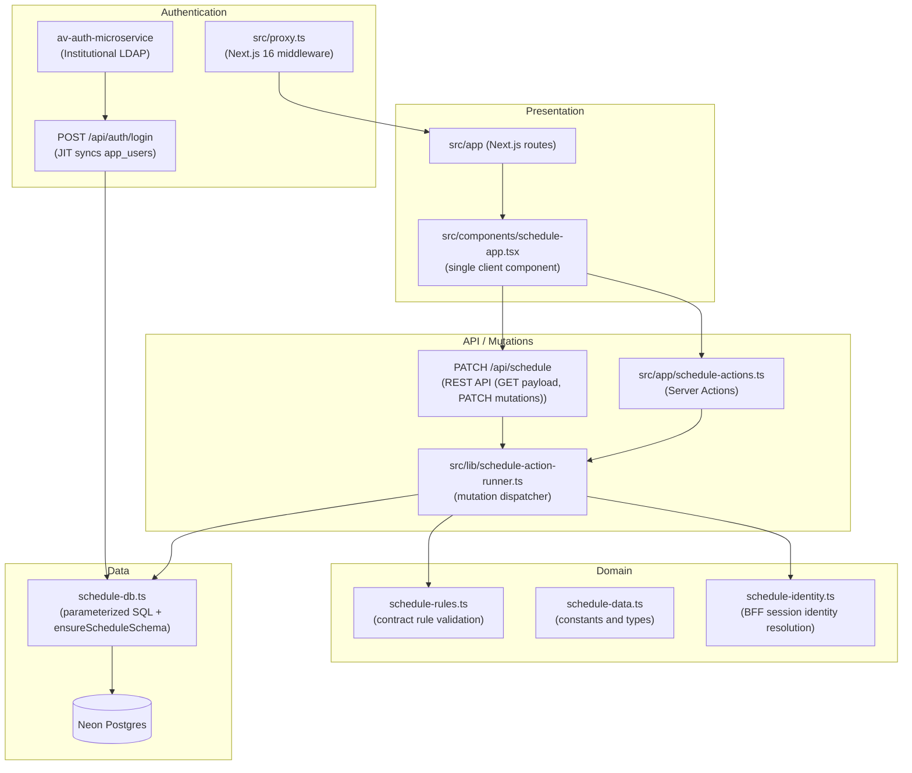

# Architecture

## Overview

Horarios UNMSM is a teacher availability registration system for the Faculty of Systems Engineering and Computer Science (FISI) at UNMSM. It lets each teacher declare their time slots and the courses they can teach, automatically validates rules by contract type, and enables the Direction office to review, flag, and approve each profile before the academic period closes.

## Principles

- **Extensibility over scalability**: the expected load is the FISI community, not tens of thousands of concurrent users. Design decisions prioritize ease of modification and code readability.
- **Logical layer separation in a single repository**: the UI, domain logic, and data access live in the same repository but in clearly bounded modules. The layer boundary is maintained by convention, not by distributed infrastructure.
- **Testable domain without a framework**: `src/lib/schedule-rules.ts` and `src/lib/schedule-data.ts` have no dependency on Next.js, auth services, or Neon. Their functions are pure and have test coverage that runs without starting the server.

## Layers



## Authentication and role flow

The faculty microservice `av-auth-microservice` acts as the central institutional identity provider connected to the UNMSM LDAP directory.

Authentication and session lifecycle are managed using a Next.js Backend-For-Frontend (BFF) approach:
1. The browser submits LDAP credentials (`identifier`, `password`) to Next.js route `/api/auth/login`.
2. Next.js calls `POST /api/v1/auth/login` on `av-auth-microservice` with `systemCode: "HORARIOS_FISI"`.
3. If valid, the user's institutional roles are mapped into an effective application role (`admin`, `direccion`, `docente`).
4. Next.js executes Just-In-Time (JIT) synchronization into `app_users` and provisions `teacher_profiles`.
5. An encrypted HTTP-only session cookie (`horarios_session`) is sealed using AES-GCM and `AUTH_SESSION_SECRET`. The client browser never touches JWT tokens.

The three roles and their permissions:

| Role | Institutional Source | Can do |
|---|---|---|
| `docente` | `DOCENTE` | Register their own availability and courses, submit their profile for review |
| `direccion` | `DIRECTOR_ESCUELA`, `DEPARTAMENTO` | View all teacher profiles, approve them, flag them, and close/reopen the period |
| `admin` | `ADMIN` | Everything `direccion` can do, plus user management, schools, course catalog, and audit |

## Design decisions

Summarized here; details in each ADR:

- **Next.js full-stack** (`docs/adr/0001-nextjs-fullstack.md`): one repository, short feedback loop, Server Components; a separate Spring Boot backend was ruled out because the need was extensibility, not horizontal scale.
- **Postgres with raw SQL** (`docs/adr/0002-postgres-raw-sql.md`): Neon Postgres with `@neondatabase/serverless` and parameterized SQL; no ORM to keep SQL transparent and didactic.
- **Institutional LDAP via BFF** (`docs/adr/0004-institutional-ldap-auth.md`): `av-auth-microservice` for LDAP authentication with encrypted Next.js BFF session cookies. (Supersedes `0003-clerk-roles.md`).

## Operations

```bash
bun run check
```

Runs Biome (lint and format), schedule-rule tests, and a production build. Requires environment variables; in CI placeholder values are used:

```bash
export AUTH_SERVICE_URL=http://localhost:5000
export AUTH_SYSTEM_CODE=HORARIOS_FISI
export AUTH_SESSION_SECRET=ci_test_session_secret_fisi_32_chars
export DIRECTION_ACCESS_CODE=ci-direction-code
export DIRECTION_EMAIL_ALLOWLIST=direccion@unmsm.edu.pe
bun run check
```

```bash
bun run smoke https://horarios-unmsm.vercel.app
```

Validates protected routes and authentication state of the deployment.

```bash
bun run ops:verify
```

Operational verification against production: checks public routes, critical env vars, schema, Neon counts, and availability and slot invariants. See README for the full command with its parameters.

The `/api/health` endpoint returns a JSON status object and requires no authentication.

## Naming conventions

URL paths, route folders, file names, code identifiers, and documentation are in English. Persisted domain values are frozen in Spanish and must not be renamed:

- Role values in `app_users.role`: `docente`, `direccion`, `admin`
- Profile status values in `teacher_profiles.status` and `teacher_sandboxes.status`: `borrador`, `enviado`, `observado`, `aprobado`
- Schedule event types in `schedule_events.event_type`
- End-user UI copy (toasts, labels, headings visible to FISI community members)

Test: does the string appear in a URL or file system path? Rename it to English. Does it get stored in the database, compared against stored data, or shown to the end user? Keep it in Spanish.

Old URLs (`/docente`, `/direccion`, `/direccion/auditoria`, `/direccion/usuarios`, `/direccion/configuracion`) redirect permanently with HTTP 308 to their English equivalents (`/teacher`, `/direction`, `/direction/audit`, `/direction/users`, `/direction/settings`) via `next.config.ts`.

## Use as a template

This repository is designed to be replicable in future faculty projects. What stays when you clone it:

- The layer structure (presentation / API / domain / data).
- The Biome, Bun, and Tailwind CSS 4 configuration.
- The institutional authentication wiring (BFF middleware, session cookie, role resolution).
- The CI pipeline (`bun run check`).

What you replace for the new project's domain:

- The domain modules (`schedule-rules.ts`, `schedule-data.ts`).
- The database schema (`ensureScheduleSchema` in `schedule-db.ts`).
- The data seeds (`scripts/seed-courses.ts`).
- The UI components (`src/components/schedule-app.tsx`).
