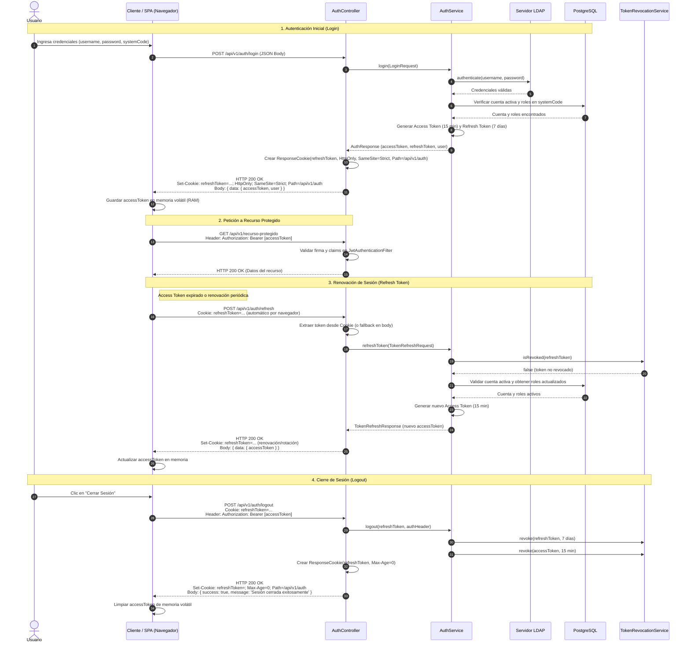

# Flujo de Autenticación Híbrida (Tokens JWT y Cookies HttpOnly)

## 1. Visión General

El microservicio `av-auth-microservice` implementa un **enfoque híbrido de autenticación** diseñado para maximizar la seguridad en aplicaciones web (SPAs) y clientes institucionales (Moodle / Aula Virtual):

1. **Refresh Token en Cookie HttpOnly:**
   - Transportado exclusivamente en una cookie HTTP con directivas `HttpOnly`, `SameSite=Strict`, `Path=/api/v1/auth`, y `Secure` condicionada al entorno (`false` en desarrollo bajo perfil `dev`, `true` en producción sobre HTTPS).
   - Inaccesible desde JavaScript en el navegador, mitigando de raíz el robo de credenciales de larga duración ante vulnerabilidades de Cross-Site Scripting (XSS).
2. **Access Token en Memoria y Cabecera Bearer:**
   - Retornado en el cuerpo de la respuesta (`AuthResponse`) para ser almacenado únicamente en la memoria volátil de la aplicación frontend (ej. estado de React/Vue), nunca en `localStorage` ni `sessionStorage`.
   - Transmitido a endpoints de recursos protegidos mediante la cabecera estándar `Authorization: Bearer <token>`, preservando la inmunidad contra ataques de Cross-Site Request Forgery (CSRF).
3. **CORS Controlado y Diferenciación por Perfil:**
   - Orígenes permitidos parametrizados mediante `CORS_ALLOWED_ORIGINS`.
   - Perfil `dev` (`APP_ENV=dev`, `@Profile("dev")`) para desarrollo local sobre HTTP y perfil no-dev para producción estricta.

---

## 2. Diagrama de Secuencia

---

## 3. Descripción de los Pasos

### Paso 1: Login
- El cliente envía credenciales mediante `POST /api/v1/auth/login`.
- Al validar exitosamente LDAP y los roles en PostgreSQL, el microservicio construye un `ResponseCookie` que encapsula el `refreshToken`.
- El cliente almacena el `accessToken` en memoria del estado de la aplicación (evitando `localStorage`).

### Paso 2: Consumo de APIs Protegidas
- Cada petición a endpoints de negocio incluye la cabecera `Authorization: Bearer <accessToken>`.
- Como los endpoints protegidos no dependen de cookies para autorizarse, la aplicación está protegida por diseño contra ataques CSRF.

### Paso 3: Renovación Automática de Tokens (Refresh)
- El cliente invoca `POST /api/v1/auth/refresh`. El navegador adjunta automáticamente la cookie `refreshToken` gracias a la directiva `Path=/api/v1/auth` y `credentials: 'include'`.
- El endpoint admite compatibilidad dual: si la cookie no está presente (por ejemplo en clientes no basados en navegador), extrae el token del cuerpo JSON (`TokenRefreshRequest`).
- Retorna un nuevo `accessToken` y actualiza la cookie en el navegador.

### Paso 4: Cierre de Sesión (Logout)
- Al invocar `POST /api/v1/auth/logout`, el microservicio registra los tokens en el `TokenRevocationService` y emite una cabecera `Set-Cookie` con `Max-Age=0`, provocando que el navegador destruya inmediatamente la cookie de refresco.

